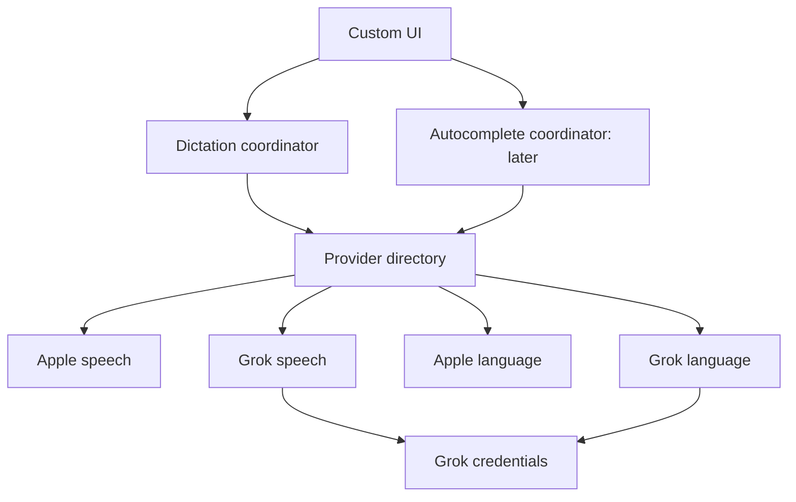
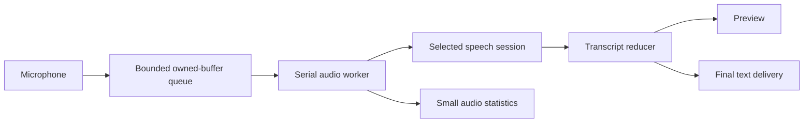

# TypeThis transcription design

Status: earlier technical proposal. The [technical implementation roadmap](transcription-implementation-plan.md) now records the current proposed defaults and complete implementation sequence. The [consolidated research brief](transcription-research-brief.md) gathers the findings and exploration behind those choices.

Proposed architecture, based on a read-only review of the local TypeWhisper checkout and current Apple/xAI documentation on 2026-11-07. No TypeWhisper engine code has been imported. These are design decisions and source observations, not measured performance claims.

The initial workload is microphone dictation into another Mac app. File transcription and meeting recording can reuse parts later, but do not determine the first implementation.

The expanded [end-to-end reference audit](/Users/sihochoi/orca/TypeThis/docs/typewhisper-transcription-audit.md) records additional capture, lifecycle, model-capability, delivery, and recovery requirements. Its findings qualify the initial defaults below; implementation should include those correctness requirements before making performance claims.

## Provider and feature boundaries

Keep two providers in the UI: Apple and Grok. Each provider exposes two independently available capabilities: speech recognition and language generation. OAuth and API keys are authentication choices within Grok, not additional providers.

Use composition with small capability interfaces:

- `SpeechBackend` prepares a transcription session for a selected speech model and locale.
- `SpeechSession` accepts ordered audio blocks, publishes transcript updates, finishes input, and cancels.
- `LanguageBackend` accepts bounded text requests. Its implementation can follow after transcription.
- A small provider directory resolves those capabilities and supplies display metadata and readiness. With two providers, an immutable directory or simple factory is sufficient.

Feature code depends on the capability it uses. The provider layer owns model-specific APIs, availability, and Grok authentication. The transcription feature owns capture policy, session state, result assembly, and delivery. UI observes session state without handling audio buffers or provider messages.

Select the speech and language models independently. A provider preset can set both, but Apple speech with Grok text generation must remain possible. Freeze provider, model, account, locale, and audio format for each running session. Changes apply to the next session.

Apple speech readiness is separate from Apple Intelligence readiness. Do not disable Apple transcription just because its language model is unavailable. Check the actual speech hardware, locale, and installed assets. Apple's assets are system-managed and shared with other apps. [Apple Speech](https://developer.apple.com/documentation/speech), [AssetInventory](https://developer.apple.com/documentation/speech/assetinventory)

Use one native application target initially, with folders and internal interfaces providing these boundaries. Separate packages, dynamic plugin discovery, a service container, and a generalized AI request language are unnecessary for this scope.

## What the TypeWhisper reference actually does

The source is at `/Users/sihochoi/Developer/Projects/typewhisper-mac`. Its short dictation and long recorder paths have different policies.

| Area | Source observation | Implication for TypeThis |
| --- | --- | --- |
| Empty and quiet dictations | `classifyShortSpeech` uses duration, exact digital silence, confirmed text, and maximum buffer RMS. It rejects recordings below 40 ms. The default aggressive policy preserves many quiet short recordings. | Preserve the distinction between absent input, digital silence, quiet sound, and actual speech evidence. Its thresholds are application-specific, not universal microphone constants. |
| Gain | `MicrophoneBoostProcessor` implements optional smoothed gain with peak protection and soft limiting. Microphone boost defaults to off. | Start without amplitude normalization; introduce gain only if a representative corpus demonstrates a benefit. |
| Format normalization | `AudioInputBufferNormalizer` selects the strongest channel and creates mono Float32 audio. This is not amplitude normalization. | Make channel selection and amplitude processing separate decisions. Prefer the selected microphone channel; do not switch channels on every block by default. |
| Longer recordings | `SoundAnalysisSpeechRegionDetector` classifies speech. The policy pads detected regions by 1.5 seconds and removes sufficiently long non-speech gaps. Reconstruction adds pauses, fades cut edges, and restores timestamps. | This is useful reference material for later long-recording work. It should not automatically become an extra stage for short streaming dictation. |
| Live feed | `StreamingHandler` polls for newly buffered samples every 350 ms. | Feeding from arriving audio can remove this periodic wait. The actual end-to-end benefit requires measurement. |
| Apple input | The shared audio representation is 16 kHz. Each Apple append builds an `AVAudioPCMBuffer`, queries the preferred format, and may construct a converter when formats differ. | Negotiate format once per session and reuse conversion state. Avoid forcing Apple audio through a common 16 kHz representation when unnecessary. |
| Retention | The capture path appends to a full recording buffer and a recovery audio store. | Recovery has value but costs storage/work. Continuous streaming does not inherently require retaining the complete recording in RAM. |
| End padding | Final batch input is padded to 0.75 seconds for shorter clips, otherwise given a 0.3-second tail. | Prefer explicit streaming finalization. Add synthetic silence only for a demonstrated backend requirement. |

Evidence in the local checkout:

- [Dictation checks and padding](/Users/sihochoi/Developer/Projects/typewhisper-mac/TypeWhisper/ViewModels/DictationViewModel.swift:6431)
- [Boost implementation](/Users/sihochoi/Developer/Projects/typewhisper-mac/TypeWhisper/Services/AudioRecordingService.swift:133) and [default](/Users/sihochoi/Developer/Projects/typewhisper-mac/TypeWhisper/ViewModels/DictationViewModel.swift:1089)
- [Channel conversion](/Users/sihochoi/Developer/Projects/typewhisper-mac/TypeWhisper/Services/AudioDeviceService.swift:3332)
- [Speech-region policy](/Users/sihochoi/Developer/Projects/typewhisper-mac/TypeWhisper/Services/SpeechOnlyAudio.swift:20)
- [Live polling loop](/Users/sihochoi/Developer/Projects/typewhisper-mac/TypeWhisper/ViewModels/StreamingHandler.swift:434) and [interval](/Users/sihochoi/Developer/Projects/typewhisper-mac/TypeWhisper/ViewModels/StreamingHandler.swift:42)
- [Apple buffer preparation](/Users/sihochoi/Developer/Projects/typewhisper-mac/TypeWhisperPluginSDK/Plugins/SpeechAnalyzerPlugin/SpeechAnalyzerPlugin.swift:475)
- [Capture processing and retention](/Users/sihochoi/Developer/Projects/typewhisper-mac/TypeWhisper/Services/AudioRecordingService.swift:3547)

## TypeWhisper preview versus final recognition

A further source review confirms three recognition paths. A changing preview followed by different final text does not, by itself, identify which path was active.

| Path | While recording | On release |
| --- | --- | --- |
| Native live session on the dictation engine | One session consumes new audio and emits draft/final segments. | Flush the tail and finish that session. Reuse its result, bypassing full-recording transcription when successful. |
| Distinct preview engine | The selected preview engine supplies display text. | Stop that preview and transcribe the complete recording using the configured dictation engine. The source deliberately treats the preview-only result as non-authoritative. |
| Batch preview fallback | Without a usable native live session, repeatedly transcribe the most recent ten seconds, with a three-second wait between attempts. Overlapping results are stabilized into the displayed preview. | Produce the final result from the complete recording. This can give the recognizer different context, but is not a guarantee of higher accuracy. |

The Appearance settings include a separate live preview engine selector. The app can also automatically select an already-loaded local streaming engine when a cloud dictation engine would otherwise upload overlapping preview windows repeatedly. This does not mean every cloud session uses two engines: Apple and xAI both have native live-session implementations in this checkout.

Apple's live session uses one `SpeechTranscriber`, publishes volatile results, accumulates finalized text, and explicitly finalizes the same analyzer on release. xAI's live session receives partial events and adopts its completion snapshot. Neither adapter's normal live path requests a second higher-quality model at release.

After recognition, the final text can still change through number normalization, speech punctuation, dictionary corrections, snippets, formatting, plugins, and an optional LLM workflow/translation step. These are text transformations, not another audio recognition pass. Failed, stalled, or incomplete live sessions can also trigger full-recording recovery.

There is separately an optional hedged recovery path: after a configured delay, a still-running final transcription can race a fallback engine, with the first successful result winning. This is actual overlapping recognition work after recording, distinct from normal preview/final handling.

Evidence:

- [Preview engine settings](/Users/sihochoi/Developer/Projects/typewhisper-mac/TypeWhisper/Views/AppearanceSettingsView.swift:120)
- [Preview engine selection](/Users/sihochoi/Developer/Projects/typewhisper-mac/TypeWhisper/ViewModels/DictationViewModel.swift:4407)
- [Final result reuse versus full-recording transcription](/Users/sihochoi/Developer/Projects/typewhisper-mac/TypeWhisper/ViewModels/DictationViewModel.swift:3244)
- [Batch preview fallback](/Users/sihochoi/Developer/Projects/typewhisper-mac/TypeWhisper/ViewModels/StreamingHandler.swift:460)
- [Apple live session](/Users/sihochoi/Developer/Projects/typewhisper-mac/TypeWhisperPluginSDK/Plugins/SpeechAnalyzerPlugin/SpeechAnalyzerPlugin.swift:550)
- [xAI transcript collector](/Users/sihochoi/Developer/Projects/typewhisper-mac/TypeWhisperPluginSDK/Plugins/XAIPlugin/XAIPlugin.swift:158)
- [Final text processing](/Users/sihochoi/Developer/Projects/typewhisper-mac/TypeWhisper/Services/PostProcessingPipeline.swift:197)
- [Hedged recovery](/Users/sihochoi/Developer/Projects/typewhisper-mac/TypeWhisper/ViewModels/DictationViewModel.swift:4128)

For TypeThis's baseline, use the selected backend's native live session for both preview and final text. Keep optional LLM text processing separate. Reconsider a full-recording quality pass only if controlled recognition tests show a worthwhile improvement relative to latency, energy, memory, and cloud usage.

## Proposed audio path

Use a narrow AudioCapture boundary, initially backed by AVAudioEngine, and validate the intended hardware routes. The reference also uses input-only HAL capture for selected devices; add such a transport only when compatibility/measurements justify it. Keep capture callbacks short: transfer audio into preallocated owned storage and use a real-time-safe handoff. Compare notification/coalescing with short active-capture polling rather than assuming either wins. Never retain a borrowed pointer past its valid lifetime. No model calls, network sends, UI updates, waits, or unbounded allocation in the callback. Buffer pooling and a bounded handoff need explicit ownership; do not describe the pipeline as zero-copy.

One ordered worker selects the channel, computes statistics, and performs only the conversion required by the selected backend. Converter state persists across blocks, preserving resampler continuity. Route or format changes trigger an explicit reconfiguration/interruption path rather than silently changing interpretation midstream.

- Apple: negotiate an analyzer-compatible format once, using the microphone format where supported; feed `SpeechAnalyzer` continuously.
- Grok: start with mono PCM16 at 16 kHz, binary WebSocket frames, and approximately 100 ms packets. Reuse URLSession and one connection per dictation. This is the straightforward baseline; Opus is a later bandwidth/energy experiment, not a required dependency. xAI documents streaming STT, interim updates, and explicit end-of-audio handling. [xAI streaming guide](https://docs.x.ai/developers/model-capabilities/audio/speech-to-text)

At 16 kHz, 16-bit mono, audio is 32,000 bytes/second. A 100 ms packet is 3,200 bytes and two seconds is 64,000 bytes, excluding object/network overhead. Captured Float32 audio at hardware sample rates uses more memory; size pools from the negotiated format.

An initial queue budget of roughly two seconds is a tuning hypothesis, not a guarantee. Bound the capture queue, encoder queue, network sends, and provider input stream. Awaiting a send or yielding to an AsyncStream alone does not establish end-to-end backpressure. On sustained overflow, stop and surface an incomplete session; do not silently drop speech or grow memory. Recovery recording, if later enabled, uses a bounded background disk spool and an explicit retention policy.

No repeated WAV encoding, base64 encoding, or HTTP request per chunk. No second transcription engine just to produce a preview. No automatic full-recording second pass after a successful streaming result.

## Empty audio, speech activity, and gain

Accumulate a small summary while processing each block: frame count, any nonzero sample, sum of squares, maximum absolute sample, and invalid/clipped sample counts. Read these statistics at stop instead of scanning the full recording again. Keep original-input measurements separate from any gain-adjusted output.

Treat these cases separately:

1. **No frames:** capture did not deliver input. Report an input/startup issue.
2. **All valid samples exactly zero:** digital silence. Do not accept generated text as speech; prolonged zero input can indicate a muted or failed route.
3. **Quiet nonzero audio:** may be a whisper, distant speech, or noise. A low RMS alone is insufficient reason to discard it.
4. **Non-speech sound:** energy is not a speech classifier. Initially let the selected recognizer handle this; evaluate an additional detector against false-positive transcripts and missed speech.

RMS is `sqrt(sumSquares / count)`. A nonnegative energy threshold can often be compared in squared form, avoiding repeated square roots. Meter display can compute a square root at its own throttled update rate. Do not infer exact digital silence from accumulated energy alone: floating-point underflow and invalid samples need separate handling.

For live dictation, preserve pauses within an active stream. Removing quiet blocks changes timing and can disrupt endpointing. Hard silence rejection at stop protects output correctness but cannot recover cloud work already performed. Preventing upload of silent recordings would require an additional start gate with its own latency, buffering, and missed-speech tradeoffs.

Keep optional amplitude normalization, automatic gain, denoising, and echo processing off normally. A targeted capture compatibility policy may require voice processing on particular routes, such as the reference's built-in three-channel call case; reproduce and test that behavior before promising universal processing-free capture. Uniform gain scales speech and background noise together; it does not improve their signal-to-noise ratio. If gain proves useful, use bounded smoothed gain with headroom and audio-duration-based smoothing, not independent peak normalization for every block. Text formatting such as spoken numbers becoming digits is a separate provider/output option.

A dedicated voice activity detector is justified only if its measured reduction in unwanted transcripts, cloud usage, or long-recording work exceeds its CPU, latency, and missed-speech costs. Tune it using quiet short words, different microphones, accents, and noisy environments rather than copying TypeWhisper's thresholds.

## Session lifecycle and transcript correctness

Use explicit states: idle, preparing, recording, finalizing, completed, cancelled, and failed. One coordinator owns transitions and a session generation identifier. All delayed callbacks and result updates must match that identifier.

Track capture continuity and delivery outcome separately from recognition state. No frames, digital silence, missing/dropped audio, recognition failure, and failed/unverified insertion need distinct outcomes. Use audio time for quiet duration and monotonic wall time for input stalls/deadlines. Bound every asynchronous phase, not just the final request. Keep a cleanup barrier so rapid restart cannot share an engine with unfinished teardown; native callbacks may outlive cancelled Swift tasks.

Install Apple assets and resolve account/model availability when the user configures the provider. On activation, start device capture and the ready backend's preparation/connection concurrently, buffering within the limit until the backend accepts audio. An audible/visible readiness signal must reflect capture readiness, not merely the hotkey event. Do not keep the microphone or all models warm while idle by default.

On normal stop: stop capture, drain accepted buffers in order, flush conversion state, signal end of input, await backend completion with a bounded deadline, then deliver the final transcript once. Cancellation closes capture and backend work promptly and prevents later insertion. Apple has a distinct explicit finalization API; ending an input sequence alone is not generally the same as finishing analysis. [SpeechAnalyzer lifecycle](https://developer.apple.com/documentation/speech/speechanalyzer)

Normalize provider results into stable segments plus a replaceable draft, with explicit completion and failure. An adapter handles provider-specific overlapping revisions. A completion snapshot replaces the assembled transcript; it is not appended to it. In particular, Grok distinguishes interim, chunk-final, utterance-final, and session completion, so treating every result as new text would duplicate words. [xAI event semantics](https://docs.x.ai/developers/rest-api-reference/inference/speech-to-text)

Coalesce preview updates independently of lossless transcript processing. Start with preview in our own panel and one final insertion into the original app/field. Track the original target and revalidate it before insertion; if focus or the target changed, retain the result for recovery rather than typing into an unrelated field. Live in-field replacement can follow as a separate platform feature.

Text delivery must distinguish confirmed, unverified, unavailable/changed target, and clipboard-only outcomes. An uncertain write must not trigger an automatic duplicate paste. If preserving the clipboard, restore only the payload we still own and allow posted-paste verification/cleanup to finish even after caller cancellation. Preserve raw recognition separately from formatted text and keep history encoding/persistence after delivery. Whole-session retry requires retained audio; optional disk spooling needs quotas, retention, and an explicit crash-durability contract.

Validate vocabulary support per selected model. The local reference passes contextual strings to SpeechTranscriber, but Apple's published guidance describes their effect for DictationTranscriber; do not advertise a benefit without target-OS validation. Grok's current API exposes keyterms despite the local adapter's unsupported declaration. Keep these as model capabilities rather than assumptions about a provider name.

The future autocomplete feature should share provider credentials and text-target/delivery infrastructure, not audio-session state. Serialize external text mutations, invalidate stale suggestions after dictation, and identify app-generated insertions so they do not reenter the human-input path.

Do not silently change provider after audio has been sent. A failed cloud session can expose an explicit retry using retained audio if recovery is enabled. The baseline preserves whatever text is confirmed and reports failure without inventing a successful completion.

## Grok authentication boundary

The local TypeWhisper xAI adapter sends an API-key bearer header. Its authenticated-CLI plugin exposes LLM providers and does not establish a Grok OAuth transcription implementation. [xAI request builder](/Users/sihochoi/Developer/Projects/typewhisper-mac/TypeWhisperPluginSDK/Plugins/XAIPlugin/XAIPlugin.swift:945), [CLI capability](/Users/sihochoi/Developer/Projects/typewhisper-mac/TypeWhisperPluginSDK/Plugins/AuthenticatedCLIPlugin/AuthenticatedCLIPlugin.swift:5)

The official Grok CLI documents OAuth, whereas the public STT reference specifies an xAI API key. Those documents do not establish that the CLI token authorizes the STT endpoint. Keep OAuth supported as a credential strategy in the architecture, but verify the supported integration, audience, scopes, refresh flow, and speech entitlement before enabling that combination. Do not present a successful CLI sign-in as proof that both capabilities are available. [CLI authentication](https://github.com/xai-org/grok-build/blob/main/crates/codegen/xai-grok-pager/docs/user-guide/02-authentication.md), [STT authorization](https://docs.x.ai/developers/rest-api-reference/inference/speech-to-text)

Keep credentials in Keychain behind a Grok credential service, with coalesced token refresh. Credential handling stays outside audio callbacks and feature coordinators. A user's own API key can be supplied at runtime; never bundle a shared application secret. An application-funded service would require a server-side credential boundary. Avoid spawning a CLI per chunk or reading its private credential files as the default integration.

## Validation before claiming an improvement

Use the same audio fixtures for both applications and each backend. Distinguish microphone startup, time to first partial, stop-to-final latency, and final insertion time. Record cold and warm p50/p95, process CPU and allocations, peak application and associated system-service memory, queue high-water marks, network bytes, and disk writes. Provider-side work and network latency are outside the application's scheduling control.

Quality gates include word error rate, missed short/quiet words, false text on silence/noise, duplicated final text, and handling of device changes, cancellation, slow networks, and absent credentials. Smaller code is not evidence of lower energy or equal recognition quality.

Lean is a development-side option for the pure core: buffer bounds and ownership-state models, session transition invariants, transcript merge rules, and equivalence of streaming statistics with a reference calculation. It does not prove Apple's or Grok's recognition quality, their execution speed, or a separately written Swift implementation. Floating-point claims need a matching arithmetic model.

Implement in this order: capability/session contracts and metrics; capture plus Apple streaming; transcript preview and final delivery; Grok API-key streaming through the same session boundary; verified Grok OAuth integration; then optional preprocessing that earns its cost in measurements. Autocomplete later consumes `LanguageBackend` through the existing provider directory.
