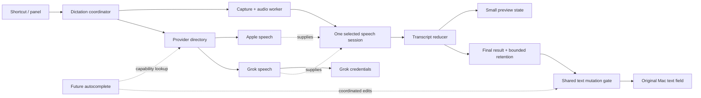

# TypeThis transcription implementation roadmap

Status: proposed implementation specification, prepared 2026-11-10. No application code or comparative benchmarks have been produced. This roadmap selects working defaults from the [consolidated research](transcription-research-brief.md), [TypeWhisper audit](typewhisper-transcription-audit.md), and [earlier design exploration](transcription-design.md). It takes precedence over conflicting candidate defaults in those earlier documents when implementing this proposal.

Design direction added 2026-11-11 from the user's explicit visual requirements. Logo reference updated to the subsequently supplied `typeThis-led-kit.zip`.

The user has selected **Apple Silicon and macOS 26+**. The current deliverable is the transcription system and the provider foundation needed by future assisted typing. Source distribution decisions are outside this roadmap at the user's request.

Read the [UI design specification](#ui-design-specification), [architecture and contracts](#3-component-contracts-and-data-model), [audio policy and limits](#5-audio-pipeline-and-explicit-resource-limits), [provider details](#6-provider-specific-implementation), [implementation milestones](#9-implementation-milestones), and [verification coverage](#11-verification-matrix-and-research-coverage) directly as needed.

## 1. Outcome and scope

Build a small native menu-bar application that records while a global shortcut is held, shows a live transcript in a custom floating panel, and delivers the final transcript to the original text field. Users select Apple or Grok speech independently of any future language-model selection. Provide an equivalent panel button for activation and cancellation.

The default path is:

```text
shortcut → snapshot intent → start input + prepare one recognizer
         → owned audio → metrics + necessary conversion → recognizer
         → revised preview → stop + drain → authoritative final
         → retain result → validate target → one delivery transaction
```

A successful recording must preserve the first and last words, account for every accepted audio block, avoid duplicate text, keep the original app focused, and leave recognized text available if delivery fails. A small binary that silently loses audio is not a successful optimization.

### Required for the transcription release

- Native arm64 macOS app, distinctive custom UI, global push-to-talk, cancel, microphone selection, locale/model selection, and clear readiness/error states.
- Apple on-device streaming transcription with model/locale/asset checks.
- Grok cloud streaming with the user's API key; supported CLI/OAuth access remains a required investigation and integration milestone, subject to actual speech entitlement.
- One selected recognition session for preview and finalization; explicit incomplete-result handling.
- Cross-app final insertion, bounded clipboard fallback, result retention, and safe manual recovery.
- Bounded capture/transport work, effective cancellation/deadlines, device-change handling, and measured release performance.
- Shared provider identities, capability readiness, selection storage, and credential ownership that future autocomplete can consume without importing audio state.
- A development-only Lean proof exercise for useful pure invariants, connected to implementation tests and measured optimization decisions.

### Explicitly deferred

The full autocomplete engine and language adapters, LLM transcript rewriting, live edits inside the target field, file imports, meeting recording, diarization, translation, auto-submit, automatic whole-recording retries, durable audio history, screen/browser context, dynamic plugins, and a second final recognizer. They have different resource and correctness costs and are not needed to establish this transcription system.

The provider foundation reserves speech and language capabilities independently; it must not advertise working language generation before those adapters exist. API key and OAuth are authentication modes within Grok, not extra providers.

## 2. Adopted stack and engineering decisions

| Area | Starting implementation | Reason and reconsideration rule |
| --- | --- | --- |
| Application | One Xcode application target, one unit-test target, arm64, deployment target macOS 26.0; pin the available stable Swift/Xcode toolchain in CI | Produces a real signed app bundle and straightforward native C compilation without a custom packaging framework |
| Language | Swift 6 language mode with complete concurrency checking; a small C audio handoff where required | Swift directly reaches Apple's speech/audio/UI APIs; C provides explicit callback storage and atomics without a second runtime |
| Shell and UI | AppKit lifecycle/menu bar/global integration and nonactivating `NSPanel`; custom SwiftUI panel/settings content | Custom drawing, typography, layout, and controls do not require a web renderer; isolate UI observation from audio |
| Speech | `SpeechAnalyzer` with `SpeechTranscriber` initially; Grok through `URLSessionWebSocketTask` | Uses native streaming and platform networking without an AI SDK or model runtime |
| Audio | `AVAudioEngine` for verified routes; narrow input-only HAL adapter for routes that need it | Keep device policy explicit; reuse proven low-level ideas without importing the reference host engine |
| Data | One capture representation, one negotiated backend representation, one transcript reducer | Avoid a universal Float32-plus-WAV payload and repeated conversion |
| Storage | Small preferences in system defaults; credentials in Keychain; bounded in-memory last results | No database or recording archive is required for the first workload |
| Diagnostics | `Logger`, `OSSignposter`, Instruments, and test-only counters/fixtures | Diagnose latency without per-block strings, transcript logging, or a telemetry SDK |
| Dependencies | No third-party production package initially; no bundled model weights | Report model downloads separately from the app bundle rather than hiding their resource cost |
| Optimization | Release measurements before changing algorithms, buffering, compiler flags, or language | Less source code is useful only when behavior and ownership remain clear |

Do not start with Rust. A Rust core would still need Apple framework bridges and would not reduce remote recognition or model execution time. Reconsider one isolated kernel only if profiling identifies meaningful app-owned work and an equivalent implementation wins after bridge, binary-size, allocation, and maintenance costs are included. Keep the existing C callback boundary if it is already sufficient.

Use internal folders and a few capability interfaces, not a framework/package for every responsibility. The following is an ownership map, not a mandate to create every file in advance:

```text
TypeThis/
  App/             lifecycle, composition, preferences, permission onboarding
  UI/              panel, settings, small observable presentation state
  Providers/       provider/model descriptors, capability readiness
    Apple/         speech adapter and asset preparation
    Grok/          speech transport, credential actor, optional supported OAuth
  Dictation/       session coordinator, transcript reducer, result store
  Audio/           capture policy, AVAudioEngine/HAL adapters, converter, metrics
    Native/        bounded storage, callback admission and lifetime primitives
  Delivery/        target snapshots, AX strategy, clipboard ownership, mutation gate
  Diagnostics/     phase metrics and benchmark entry points
TypeThisTests/     pure state, protocol, ownership, failure and delivery tests
Benchmarks/        fixtures, reference transcripts, scripts, recorded results
Verification/     pinned Lean project and implementation correspondence notes
script/           build_and_run.sh, test.sh, benchmark.sh
```

Use concrete structs and enums for data. Introduce protocols where there are actual alternatives: capture transport, speech session, credential source, text-target operations, and a test clock. Avoid protocol/type-erasure wrappers around every small helper.

### UI design specification

**Required direction:** deep black surfaces, white text, rounded corners, generous empty space, and a few deliberately placed elements. The interface should feel quiet, minimal, and precise. This is the visual specification for implementation, not an invitation to invent a different theme. It applies to app-owned surfaces in both macOS light and dark appearance; OS-owned permission/login dialogs retain their system presentation.

#### Palette and geometry

| Token | Value / use |
| --- | --- |
| Background | `#000000`, opaque window and panel base |
| Raised surface | `#080808`, only where a subtle separation is needed |
| Control surface | `#121212`, restrained hover/pressed/selected treatment |
| Hairline | `#242424`, optional 1 pt boundary on floating panels and controls |
| Primary text and icons | `#FFFFFF` |
| Secondary text | `#B3B3B3`, limited to supporting labels and hints |

Keep interface chrome entirely achromatic. There is no highlight/accent color: selection, keyboard focus, recording, success, and errors use white strokes, icons, shape, and concise text. The supplied LED wordmark retains its red-to-orange artwork as the only color exception; do not spread its colors into controls or backgrounds. Explicitly style app controls so default blue tints do not appear. Keep text legible rather than making necessary labels nearly invisible.

Use a small 8 pt spacing grid: 24–32 pt outer padding, 24 pt between content groups, and 8–12 pt within a group. Start with 24 pt window/panel corner radii and 12 pt control radii. Use rounded shapes consistently without enclosing every row in a separate card. Surfaces are solid black; omit decorative gradients, glow, glass blur, textures, and oversized shadows.

Use the system sans-serif font to avoid a bundled font dependency. Body/control text starts at 13–14 pt, live transcription at 16–18 pt with comfortable line spacing, and a rare heading at 20 pt. Prefer regular/medium weights, sentence case, and left-aligned content. Establish hierarchy through space, size, and weight. Keep visible chrome text to short labels; show explanations only when a setup step or error requires them.

#### Logo reference

Use the **user-supplied typeThis LED wordmark** as the app's logo. This replaces the earlier Grok bot direction. The source was `/Users/sihochoi/Downloads/typeThis-led-kit.zip`; an unchanged copy is preserved in [typeThis-led-kit.zip](assets/typeThis-led-kit.zip), with the kit's existing [dark preview](assets/typeThis-led-preview.png) available for visual reference. Preserve the circular LED brush lettering, red-to-orange gradient, proportions, and solid light “This” lettering. Use the supplied geometry rather than recreating the wordmark with a font or inventing another symbol.

Inside the archive, `typeThis-led/typeThis-led-static-dark.svg` is the transparent static artwork for dark surfaces; `typeThis-led-static.svg` is its light-background counterpart. Use the dark version on the app's `#000000` base. The preview's near-black rectangular background is presentation framing, not a new UI background token. Fit the wordmark around 200–240 pt wide in the main/settings header, preserving aspect ratio and giving it generous clear space. Keep the compact recording overlay focused on transcription rather than repeating the full wordmark.

The kit provides a wide wordmark, not a finished square macOS app icon or tiny menu-bar asset. M1 includes preparing an app-icon composition from this identity and checking legibility at actual Dock/Finder sizes. Use a native monochrome microphone/status template glyph in the menu bar until a suitable compact brand rendition exists; do not squeeze the whole wordmark into an 18 pt glyph or reinstate the bot. Keep this adaptation explicit rather than assuming the archive already covers every icon size.

Use a **static production asset by default**. The source contains 4,635 LED emitters; render/export it during asset preparation into appropriately sized native assets, or use a validated single-image representation. Do not create a SwiftUI view/layer per dot or rebuild LED geometry during rendering. Include only needed production exports in the app bundle. Keep the source ZIP, generators, HTML playground, JavaScript engine, GIF, and video in design tooling/documentation, outside shipped resources and runtime dependencies.

The kit's animated SVG and reusable entrance animation remain optional design references, not a requirement to add a WebView or animation engine. No looping logo, animated Dock/menu-bar icon, launch delay, or branding work on the recording path is required for this release. Any later entrance animation must be finite, respect reduced motion, and justify its native implementation and measured cost separately. The normal idle logo remains still.

#### Surface composition

- **Main/settings panel:** start around 520 pt wide, with height determined by content and generous padding. Put the supplied wordmark in a spacious header and a quiet close/settings action at the upper right as appropriate. Use one aligned column of essential label/value rows for provider, model, microphone, and language; reveal account controls only when relevant. Place one clear recording action below. Keep secondary options behind a compact disclosure. The surface remains sparse; provider choices are compact controls, not promotional cards or a dashboard.
- **Recording overlay:** a separate nonactivating black rounded panel, initially around 360 pt wide, positioned near the bottom of the active screen without covering the target caret when practical. Show a small white activity indicator, one short status such as “Listening” or “Finishing,” and a cancel control. Reveal a bounded two-to-four-line transcript viewport as text arrives; longer results remain scrollable/recoverable rather than expanding across the desktop. Keep the original editor focused.
- **Result/error state:** reuse the same visual language and space. Keep the transcript primary; show only relevant actions such as “Copy,” “Retry,” or “Open settings.” Distinguish incomplete or unverified outcomes with an icon and a short actionable message. Minimal text must not hide lost audio, delivery uncertainty, or permission problems.

#### Interaction, accessibility, and efficiency

Hover, press, selection, and keyboard focus remain monochrome; use a visible white focus outline and accessible names for icon-only buttons. Give small visual controls at least 32 pt hit areas. Settings can activate when explicitly opened; recording preview must preserve the external target's focus. Support VoiceOver, sufficient contrast, and reduced motion.

Use brief opacity/state transitions only where they clarify a user action. Keep the logo and idle UI still. If an audio indicator animates, update a few simple bars from coalesced level summaries at at most 20 Hz while visible and recording; never bind rendering directly to audio callbacks. Reuse these few tokens and components in native SwiftUI/AppKit. The design adds no web view, continuous decorative rendering, third-party theme framework, or custom animation engine.

Visual acceptance: inspect main/settings, connecting, listening with preview, finalizing, and result/error states at normal and Retina scale, in macOS light and dark appearance. Verify deep black surfaces, white/gray interface content, no colored accents outside the supplied LED wordmark, faithful wordmark geometry, generous spacing, restrained copy, rounded corners, and visible keyboard focus. Check app-icon exports separately at small sizes. Correct visual drift before marking the UI milestones complete.

## 3. Component contracts and data model



### Provider boundary

`ProviderDirectory` is an immutable Apple/Grok lookup built at app launch. A `ProviderDescriptor` contains stable identity and display metadata. A `ModelDescriptor` contains the provider model ID, capability, supported/verified options, locale policy, and input contract. Keep model IDs in one versioned descriptor, not scattered literals or an unbounded remote catalog cache.

`CapabilityReadiness` distinguishes unsupported hardware/locale, missing assets, downloading, missing credentials, authentication failure, entitlement unavailable, preparing, and ready. Apple speech readiness is independent of Apple Intelligence language-model availability. Grok readiness is per credential/account, model, and capability; a successful login is not proof of speech access.

`SpeechBackend` prepares or creates an isolated `SpeechSession` from a frozen request. The session provides:

- A negotiated audio input specification, readiness signal, and bounded transcript-event channel.
- One sequential audio sink with explicit admission/ownership outcome.
- End-of-input/finalize, explicit cancel/close, and a cleanup completion signal.
- Typed failures and health/progress observations; transport submission is not an inference acknowledgement.

The exact Swift signatures follow the SDK ownership experiment in M0. Do not disguise an unbounded `AsyncStream` as a backpressured sink. If a framework retains buffers after accepting them, its adapter must account for those leases separately.

Reserve an independently selected `LanguageModelSelection` and a future `LanguageBackend` boundary for bounded text requests. Do not implement placeholder LLM networking, dummy availability, or a generalized prompt pipeline in this release. Later, Apple and Grok language adapters use the same provider IDs and Grok credential actor while owning their own tasks and readiness.

### Core values

| Value | Required contents and invariants |
| --- | --- |
| `SessionID` / generation | Unique session and capture generation; all async events and native work carry the relevant identity |
| `SessionConfiguration` | Provider/model/account reference, locale, formatting/vocabulary options, input UID/channel policy, target token, and hard limits; immutable during a session |
| `AudioBlock` / lease | Owned storage, format, source frame interval, frame count, continuity flags, generation; never an escaped pointer into a reused callback buffer |
| `AudioHealth` | Captured, accepted, consumed, converted/submitted, lost/invalid frame counts; queue high-water marks; reasons for gaps and incomplete recognition |
| `TranscriptEvent` | Session, provider revision/identity, source time span where available, event kind, replacement scope, text; distinguish draft, finalized span/utterance, and complete-session snapshot |
| `TranscriptState` | Ordered stable spans plus replaceable draft; bounded bytes/spans; no append-only interpretation of overlapping/cumulative events |
| `FinalResult` | Provider original, optional app-formatted output, selected model/locale, audio and recognition completeness, typed failure if any, timestamps, and delivery outcome |
| `TargetSnapshot` | Process identity including start identity, focused field identity, selection/caret and relevant text revision/context, secure/unsupported status; avoid a full-document copy |
| `DeliveryOutcome` | Confirmed, attempted-but-unverified, target-changed, unsupported, clipboard-only, failed, or cancelled-before-commit; recognition success is separate |

Use UTF-16 for AX text ranges and explicit conversions at that boundary. Keep audio sample positions in integer source frames with an explicit sample rate; represent conversion ratios/timestamps without accumulating block-by-block floating-point drift. Use monotonic time for deadlines, never wall-clock calendar time.

### Transcript assembly

Adapters translate their own protocol into reducer operations with explicit replacement scope. Tests must cover repeated revisions, cumulative utterance finals overlapping chunk finals, reordered/stale callbacks, and a final full-session snapshot that differs from preview. Keep stable chunks without rebuilding the entire transcript on each partial. Join/cache for UI only when text changes and for output once at finalization.

For Apple, map the result's actual audio range and finality rather than inventing generic append semantics. For Grok, chunk-final, stitched utterance-final, and session-completion events have different scopes. The complete-session snapshot replaces the assembled result when valid; never append it to already accumulated text. If range/identity guarantees are absent or inconsistent, preserve an incomplete result and protocol diagnostic rather than guessing that it is complete.

Draft updates may be coalesced to the latest revision. Stable/completion/error events must not be dropped. Event overflow is a session failure, not a silent truncation. A finalized span is not sufficient evidence that the entire recording was recognized.

## 4. Concurrency, ownership, and lifecycle

### Execution ownership

- **Main actor:** app/panel state, lightweight target discovery, serialized AX/clipboard operations, and user actions. Large audio loops, JSON decoding, and model/network waits do not run here.
- **One dictation coordinator actor:** state transitions, session configuration, deadlines, generation checks, result publication, and ordered cleanup. It does not receive every raw sample.
- **Native audio callback:** render/copy into admitted preallocated storage and publish counters/indices. Our callback code does not allocate, wait on locks, call actors, log, create tasks, run models, convert formats, or use the network.
- **One serial audio worker:** drain, continuity checks, signal summaries, channel mapping/conversion, and bounded delivery. Preserve order and avoid a task or actor hop per sample/block.
- **Backend-owned work:** one sequential sender/input feeder and one event reader per active session, plus required framework analysis tasks. Keep task handles and explicit close paths; do not let detached work accumulate.
- **Grok credential actor:** Keychain references, single-flight refresh, generation/account checks, expiry handling. Features share credentials, not sessions.

Use a callback-safe handoff verified for the actual producer topology. A single-producer/single-consumer ring is valid only if that capture adapter guarantees one serialized producer. Confirm that atomics are lock-free on the target; document memory ordering and counter wrap assumptions. A signalling primitive must also be callback-safe. Compare coalesced notifications with a short active-capture drain timer if necessary; do not add permanent idle polling.

### Session state

Use a small explicit state machine:

```text
idle → starting → recording → draining → finalizing → delivering → idle
            ↘          ↘          ↘           ↘
                    cancelling / failed → cleaning → idle
```

Capture readiness and recognizer readiness are substate facts, not extra ambiguous `isReady` booleans. `recording` means the session is armed and real frames are arriving; preparation may still consume a bounded initial backlog. Show a distinct input-ready cue and any connecting condition. Finalizing and delivering remain visible even after the mic is closed.

Every transition has one owner. Every terminal path settles once. Events from an old generation cannot publish a result, deliver text, return a block to a new pool, or stop a new device. Never release native callback context because a Swift task was cancelled; first close admission, stop the producer, and establish callback quiescence.

### Start sequence

1. On key-down, reject repeats; snapshot lightweight target identity and immutable settings. Do not read browser URLs, icons, history, or the whole document.
2. Check cached permissions/readiness. Permission prompts, model downloads, and account login occur through setup, outside an active push-to-talk attempt.
3. Start input and prepare/connect the selected recognizer concurrently, using the bounded startup backlog. There is no always-running microphone or audio pre-roll by default.
4. Start the usable-audio metric at the first valid callback, not engine `start()` return. Retain the first frames while the backend becomes ready; fail explicitly if its readiness exceeds the backlog budget.
5. Negotiate/reuse conversion, drain in order after readiness, and publish a small preview state. Initial cloud backlog must obey the provider's tested pacing rules; do not burst it blindly or retain a growing latency debt.
6. If key-up/cancel occurs during start, record that intent immediately. Never let a late start completion leave the microphone active or create an unsolicited new recording.

### Finish sequence

1. On key-up, snapshot the stop boundary, stop input production, and close callback admission in the transport's safe order. Preserve all frames already accepted before the defined stop boundary.
2. Wait for callback quiescence; drain accepted blocks and flush the persistent converter. Flush a short final Grok packet immediately instead of waiting for a full packet interval.
3. End the backend input only after the drain barrier. Await the authoritative finalized result under the finalization deadline.
4. Store the final/original text before attempting delivery. Apply only enabled bounded deterministic formatting, then revalidate the original target and perform one transaction.
5. Settle delivery certainty and necessary clipboard cleanup. Release capture/backend resources and return to idle only after the relevant cleanup barrier.

After draining, classify a session with no valid frames as no-input, and a session whose valid input is entirely digital zero as empty. Neither produces an automatic text insertion, even if a backend emitted suspect text. Nonzero quiet input always remains eligible for recognition; absence of a partial during silence is not by itself an inference stall. Treat a nonempty recording with no authoritative result as no-result/incomplete according to the backend outcome, never as proven empty speech.

Do not copy the reference's short-clip padding or extra capture constants. Initially add no synthetic silence or post-release microphone tail. Test short syllables and converter latency first; introduce a narrowly documented backend requirement only if the quality test demonstrates it.

### Cancellation and recovery

Cancellation stops future uncommitted delivery, closes native/transport work, and discards uncommitted audio. If a paste/write was already posted, its verification and owned clipboard cleanup must still settle. Cancellation cannot promise to undo an external edit.

A deadline handler must be able to publish a terminal failure even if a provider task is uncooperative. Calling `Task.cancel()` or racing child tasks in a structured task group is insufficient when group exit still awaits a hung child. Use explicit native/transport close, generation fencing, and bounded resource quarantine. Permit no accumulating replacement sessions behind abandoned native work; if quiescence cannot be established, disable capture with a recoverable error instead of freeing live memory.

For input loss, disconnect, sleep, or route change during recording: close the session, retain any clearly marked incomplete text, and require a fresh recording by default. Allow bounded initialization retries before accepting real audio only where safe. There is no seamless mid-stream resume without a verified provider resume protocol and complete audio accounting.

Handle shortcut release loss, app deactivation, event-tap disablement if applicable, sleep/lock, and app termination. Use an event-driven shortcut implementation for the supported key combinations; avoid continuous key-state polling. Never suppress unrelated keys.

## 5. Audio pipeline and explicit resource limits

### Capture and conversion policy

Persist microphone UID, not transient Core Audio device IDs. Resolve and validate each session. Follow the system input only when the user selected that policy; an explicit device disappearing must not silently record a different microphone. Verify the route format and channel layout before starting.

Start with the default/built-in route through `AVAudioEngine`. Add the narrow HAL path for explicit external/virtual routes that require it based on M0/M3 measurements. Select a verified microphone channel or stable documented mapping; do not choose the loudest channel independently every block. Avoid cancellation from blindly averaging opposing channels.

Negotiate the Apple analyzer's acceptable format once per session. Reuse one converter if necessary. Grok initially receives mono signed PCM16 little-endian at 16 kHz. Conversion, channel mapping, statistics, and packet assembly belong on the worker. Do not create WAV headers, base64, a second complete Float32 recording, or a converter for every block.

An `AVAudioPCMBuffer` can wrap owned memory with a deallocator, but that is an optimization opportunity, not proof of safe zero-copy. Verify analyzer retention and SDK concurrency behavior. Return pooled memory only after its actual consumer lifetime ends, never merely after `yield` or an async append returns. Begin with a bounded owned-buffer implementation and optimize copies only when lifetimes are demonstrated. [Apple PCM buffer API](https://developer.apple.com/documentation/avfaudio/avaudiopcmbuffer), [Apple sample-rate conversion guidance](https://developer.apple.com/documentation/technotes/tn3136-avaudioconverter-performing-sample-rate-conversions)

### Signal handling

Calculate input summaries once per worker block: count, sum of squares, maximum magnitude, nonzero count, clipping, and invalid samples. Aggregate with counts across blocks; averages of unequal-sized block RMS values are incorrect. Metrics used to reject digital silence refer to input before gain.

Separate no callbacks, zero frames, all-zero finite samples, quiet nonzero input, non-speech noise, and recognizer no-result. Use exact all-zero detection as one strong fact; do not reject quiet speech using an amplitude threshold. A stalled mic is not silence. Preserve quiet intervals inside an active stream so the backend keeps the correct timeline.

Gain, amplitude normalization, denoising, separate VAD, automatic end-of-turn, and silence cutting are off initially. Uniform gain does not improve signal-to-noise ratio. Validate NaN/Inf and clipping handling explicitly and account for unusable frames. A targeted voice-processing compatibility path may be required while a call app is active; reproduce it on supported devices, document the predicate, and restore owned effects on every exit.

For a threshold optimization, compare sum of squares with `N × threshold²` when the domain and floating-point behavior justify equivalence. Do not calculate square roots merely to produce a yes/no gate. This is a candidate to verify and benchmark, not a reason to add a silence gate that harms quality.

### Starting limits

These are explicit engineering defaults to exercise in M0 and lock before M3. They are not measured optimal values. Changes need a recorded memory/latency/quality result, not silent budget inflation. All byte limits include pending/in-flight ownership under our control, not just entries still sitting in a queue.

| Resource or deadline | Initial policy | On reaching it |
| --- | --- | --- |
| One dictation | 10 minutes maximum, warning before the limit | Stop, drain, finalize; never discard the tail silently |
| Source callback ring | Approximately 2 seconds, rounded to safe capacity; allocate from validated route rate/channels with an 8 MiB byte ceiling | Fail/incomplete on loss; reject unsupported oversized route before capture |
| Total app-owned pending audio beyond the ring | At most 2 seconds across converter staging, backend leases, and sender; 8 MiB ceiling | Stop rather than evict speech or spawn more send tasks |
| Startup queue | Shares the preceding limits; oldest queued audio at most 2 seconds | Readiness failure; do not claim the first word was preserved after overflow |
| Active pending-audio age | Oldest unsubmitted source interval at most 2 seconds behind live capture, across ring, worker, and backend queue | Incomplete/error; measure backlog rather than assuming an awaited send is ASR progress |
| Grok packet | Start at 100 ms / 3,200 bytes at 16 kHz PCM16; flush tail immediately | Tune only against end-to-end latency, CPU/wakeups, and provider behavior |
| Provider event/message | 1 MiB maximum transport message; decode once, cap text before retaining | Protocol/resource failure, never truncate into a success |
| Current transcript | 256 KiB UTF-8 total, at most 8,192 retained spans | Controlled stop or explicit incomplete-result failure; no quadratic rebuilding |
| Pending semantic events | 64 stable/control events plus one replaceable latest draft; 256 KiB retained text total across this channel | Fail on stable-event/byte overflow; coalesce draft and UI updates |
| Retained results | Last 3 results, at most 1 MiB total, process lifetime; clear on quit or user action | Evict oldest whole result; no audio or crash-durability promise |
| Clipboard backup | Snapshot all restorable types within 16 MiB, owned for at most 2 seconds after posted paste | If preservation is impossible, require an explicit copy action; never silently destroy previous contents |
| Capture first-frame watchdog | 2 seconds built-in/USB; 5 seconds Bluetooth | Close input and report no usable input |
| Active input watchdog | 2 seconds without advancing source frames after input became ready | Report stalled input and close; arriving zero samples remain live input |
| Backend setup | 5 seconds connect; 8 seconds absolute setup including readiness; startup audio still has its own 2-second cap | Close and fail; no secret extension of audio retention |
| Local drain | 1 second for callback quiescence and app conversion after stopping the producer | Incomplete/cleanup failure, retaining ownership until safe release |
| Backend tail submission | 3 seconds absolute after stop, including any provider-required pacing of the allowed backlog | Close/fail as incomplete; do not end input before submitted tail or silently drop it |
| Finalization | 15 seconds absolute after ending input | Close/fence backend, retain incomplete text, return a clear outcome |
| Automatic external delivery | 2 seconds total from first mutation attempt, including owned cleanup | Mark unverified/failure as appropriate; no automatic duplicate attempt |

Use frame counts and actual allocation sizes to derive capacities; record the maximum callback slice and converter scratch size. Raw and converted queues may represent overlapping audio and must still meet both time and byte caps. Opaque buffering inside Apple or networking cannot be bounded merely by our queue limits: measure retained buffers/physical footprint, establish adapter admission limits where possible, and state residual uncertainty.

Tail submission and finalization have different clocks: the former starts at stop and permits the already allowed backlog to drain at a supported pace; the latter starts only after end-of-input. A one-second local conversion deadline must not accidentally cut off two seconds of legally queued cloud audio.

Dynamic availability polling, key-state polling, idle audio timers, full-session PCM retention, and disk recording are absent from the normal path. Preferences/asset checks occur on relevant events and at setup. Model assets may remain installed without leaving the microphone open.

## 6. Provider-specific implementation

### Apple

1. Query actual module/hardware and locale availability; enumerate supported locales dynamically. Resolve the user's locale against that inventory and display unsupported status without silently using another language.
2. Prepare/download system-managed assets from settings before activation. Hold required reservations/resources while active, and release according to the chosen retention policy. Start with bounded active-use retention; compare framework-supported lingering retention against cold/warm latency and system memory before enabling it by default.
3. Construct `SpeechTranscriber` and one `SpeechAnalyzer`, negotiate format, start input and result consumers, and normalize volatile/final results through the reducer.
4. End the input sequence after draining, then use `finalizeAndFinishThroughEndOfInput()` and consume completion. Use `cancelAndFinishNow()` for cancellation, with the ownership and deadline safeguards above. [Apple SpeechAnalyzer lifecycle](https://developer.apple.com/documentation/speech/speechanalyzer), [AssetInventory](https://developer.apple.com/documentation/speech/assetinventory)
5. Test `DictationTranscriber` as a selectable alternative only when it earns its added surface through availability, accuracy, latency, or needed vocabulary support. It remains the Apple provider, not a third provider or simultaneous recognizer.

Do not assume contextual vocabulary works on every Apple speech module. Apple's engineering guidance identifies `DictationTranscriber` as the module honoring contextual strings in the discussed implementation; validate on the minimum and current supported OS before exposing the option. Speech capability must remain usable independently of Foundation Models readiness. [Apple vocabulary clarification](https://developer.apple.com/forums/thread/811083)

M0 also checks current SDK availability for any newer capture helpers. Adopt one only if it preserves necessary input selection, buffer ownership, stop semantics, and instrumentation with less code and equivalent measurements; do not adopt a helper simply because it is newer.

### Grok API-key speech

Use native TLS/WebSocket transport to `wss://api.x.ai/v1/stt` with Bearer authorization. Wait for `transcript.created`; send ordered binary PCM packets; send `audio.done` after draining; consume `transcript.done` before settling completion. Distinguish interim, chunk-final, and utterance-final events. The current documentation recommends 100 ms PCM packets; validate and pin the model ID in M0. [Grok streaming protocol](https://docs.x.ai/developers/model-capabilities/audio/speech-to-text)

Use one sender and one receiver. Set message and queue limits before connecting. Decode a typed event envelope once and route errors explicitly. Preserve packet order and audio timestamps. Record local send completion as transport progress only; it does not establish the server has recognized that interval.

Freeze language, provider formatting, filler handling, and verified vocabulary options for the session. The public API documents speech options separately from the CLI; validate each supported option with fixtures before advertising it. Do not implement an additional utterance-finalize message merely to stop a one-recording connection: use the documented end-of-audio path. [Grok STT API reference](https://docs.x.ai/developers/rest-api-reference/inference/speech-to-text)

Default to one connection per dictation; no permanent idle socket or speculative reconnect. Do not automatically replay after audio has been submitted. Without retained audio and a supported resume/acknowledgement contract, reconnect can lose or duplicate speech and may incur another request. Authentication/rate-limit failures are typed outcomes; any pre-audio retry must fit the original deadline. Cancellation and permanent errors are not retry candidates.

Initially use the user's own API credential stored in Keychain; never embed a shared product secret in the app. Credential validation must actually establish speech access, not merely success on a text endpoint. Credential changes invalidate future readiness and cannot silently switch an active session's account.

### Grok CLI/OAuth

This is a feasibility gate, not an assumed implementation detail. The official CLI documents sign-in and device authentication, but those facts alone do not establish a supported third-party speech OAuth flow. [Official CLI reference](https://docs.x.ai/build/cli/reference)

M0 must record the supported integration surface, client registration requirements, grant flow, token audience/scopes, refresh rules, speech endpoint entitlement, and whether a separate text capability uses the same credential. Test a minimal speech request with a legitimately supported account/flow before designing a full login UI.

- If an approved native OAuth flow supports speech: implement it using `ASWebAuthenticationSession` and PKCE/state or the provider's documented device flow, with single-flight refresh and Keychain storage. Test denial, cancellation, expiry, revocation, account changes, and concurrent speech/text refresh requests.
- If access is supported only through an official CLI interface: use that documented interface only for capabilities it actually exposes. A subprocess wrapper must have bounded lifetime/output and effective termination; no CLI process per audio block or bundled terminal/agent runtime.
- If no supported OAuth speech integration exists: keep that combination explicitly unavailable and document the evidence. Continue Apple/API-key implementation, but mark the original OAuth speech requirement unresolved. Do not declare the entire requested access scope complete without support or a subsequent user-approved scope change.

Do not depend on scraping private CLI token files, undocumented token exchange, copying a private client identity, or assuming a Grok subscription confers API speech entitlement. Implement a small credential strategy boundary; do not build a speculative universal auth framework.

## 7. Output, text delivery, and future typing coexistence

### Output and recovery defaults

Keep provider original and delivered output separately. Provider original is not guaranteed word-for-word audio: provider formatting may already have changed it. Start with provider output and at most explicit whitespace/newline options; do not add English-only punctuation rewrites to all locales. No default LLM cleanup or incremental postprocessing.

Keep the bounded last-result store in memory before delivery, including incomplete text with its status. Offer Copy and an explicit retry-to-current-target action after a target change or ambiguous outcome. A retry must explain that an earlier unverified write could already have applied; never silently retry it.

Do not record audio to disk by default. The two-second queue cannot replay an entire recording. Consequently, a cloud failure can leave only incomplete text and require speaking again; the UI must say so. This chooses lower disk, memory, and code cost over automatic whole-session recovery. If a future product requirement adds replay, implement an opt-in incremental spool with byte/time quota, disk-full handling, deletion policy, crash-valid container/journal semantics, and separate performance measurements. The reference's handled-failure WAV behavior is not a crash-durability guarantee.

### Delivery transaction

1. Capture the target before panel presentation; keep the panel nonactivating so the original app retains focus. Secure fields, unsupported targets, and IME composition require explicit handling rather than broad insertion assumptions.
2. Revalidate process, field, selection/caret/context before mutation. If the user changed focus or edited the target, retain the result and request an explicit user action in the panel instead of inserting elsewhere.
3. Choose a previously verified strategy for that target: supported AX selection replacement or one synthesized paste. Do not first replace a whole document to insert a few words.
4. Verify the expected local change when safely readable. AX success may be a no-op; an error may still have applied. If the result is ambiguous, classify it as unverified and stop. Automatic paste after an uncertain AX write risks duplication.
5. For paste, snapshot restorable clipboard items/types and `changeCount`; write the payload; post the paste; keep it alive for a bounded consumption/verification interval. Restore only while still owning that clipboard generation. A newer user copy wins. If complete preservation is unavailable or exceeds the bound, use explicit Copy with disclosure instead of an automatic destructive fallback.
6. Serialize mutations/clipboard ownership through `TextMutationGate`. Settle posted-operation cleanup even when the dictation is cancelled. No subsequent recording may corrupt an outstanding paste payload.

Test native `NSTextView`/TextEdit, a browser textarea/contenteditable, an Electron editor, and a terminal independently. Publish the actual support matrix; do not promise that all applications expose readable fields or verified insertion. Readability and successful insertion are separate capabilities. Treat secure input and unsupported composition conservatively.

Initially pause future autocomplete while dictation is active or delivery is pending. The mutation gate increments a context revision and labels edits with their origin, so stale suggestions are cancelled and our own insertion is not interpreted as human typing. Safe undo and live in-field preview remain separate later features; never implement undo by blindly deleting the last N characters.

## 8. Performance targets and measurement design

Separate app-owned overhead from microphone/OS, recognizer, network, and editor time. The end-to-end experience is the final measure; the decomposition explains where an optimization can help. Reducing app-process memory by moving work into an Apple service is not a reduction in total workload memory.

### Metrics and provisional budgets

| Measurement | Initial target or reporting rule |
| --- | --- |
| Signed arm64 `.app`, uncompressed / distribution archive | Target ≤15 MiB / report compressed size separately; exclude dSYMs from shipped bundle, report system assets separately |
| Idle app physical footprint | Target ≤50 MiB after setup has settled; report retained model/system-service memory separately |
| Active app-owned audio storage | Enforce the explicit pool/queue caps; no growth proportional to full recording duration |
| Idle work | Mic closed, no audio/network/key-state polling timers, no recurring feature work; measure app-attributable wakeups and CPU over a quiet 5-minute window |
| Shortcut → feedback | Target p95 ≤ one display frame for local state publication; readiness must still reflect real audio |
| Warm built-in shortcut → first usable frames | Target p95 ≤150 ms; report cold and Bluetooth separately instead of asserting this for every route |
| App audio worker | Target ≤2 ms CPU per 100 ms of audio at common routes, excluding model/network wait; profile callback worst cases separately |
| Callback work | Preallocated bounded operations only; measure p50/p95/max against each device's actual callback deadline, not a universal microsecond claim |
| Audio publication to backend handoff | Target p95 ≤30 ms for Apple when no conversion backlog; Grok adds at most its packet accumulation interval before transport wait |
| First partial | Report from first speech sample and from first usable audio; distinguish backend emission from panel render, without inventing a model latency guarantee |
| Key-up → final / delivery | Report provider final, app formatting, mutation attempt, confirmed/unverified delivery, and clipboard cleanup separately; target app-owned non-clipboard work ≤50 ms p95 |
| Quality and integrity | Zero silently dropped frames, zero duplicate automatic edits, zero success reports for incomplete audio; record WER and quiet/short-word retention against the same inputs |

These are starting engineering targets, not claims about current performance. M0 measures the framework/UI floor and records realistic accepted budgets before implementation. A miss should produce a profile and a specific decision; do not quietly redefine the metric. Hardware-dependent p95 gates run only on a stable benchmark host. Hard correctness/resource limits apply regardless of performance variance.

Use signposts for input intent, capture start/first frame, backend ready, first submit, first partial, stop, last accepted/drained audio, end-input, final result, delivery attempt/verification, and cleanup. Keep counters for copies, allocations where measurable, queue age/high water, dropped frames, outstanding buffer leases, bytes uploaded, retries, and disk writes. Correlate by anonymous session ID. Do not log transcript/audio contents, credentials, or a string for every callback.

### Benchmark protocol

- Build Release for arm64. Compare equal functionality and the same model, locale, format, hardware route, enabled options, and corpus. Keep Debug/sanitizer results separate from performance results.
- Use deterministic prerecorded injection for pipeline/reducer/network fixtures and physical microphone trials for actual startup, routing, voice quality, and tail behavior. A file replay cannot establish microphone readiness latency.
- Record cold launch/model-cold/model-warm conditions explicitly. Separate first-use asset download from normal startup; do not drop it from the installation-cost report.
- Use paired runs with at least 30 representative samples per latency variant, report sample counts/distributions and outliers, and repeat only when noise or changes justify it. Network timings need environment/RTT context; they are not stable local microbenchmark gates.
- Compare TypeWhisper with equivalent features/settings, without resetting the user's preferences or running its destructive benchmark setup. Report launch, idle/active CPU, energy/wakeups, app plus associated service memory, allocations/copies, release-to-final, delivery certainty, and quality together.
- Include quiet/short speech, silence/noise, names/numbers/punctuation, accented speech, supported non-English samples, and recordings near the duration cap. Track false rejection of quiet speech and hallucinated text on silence separately from overall WER.
- Store machine/toolchain/OS/model/options, fixtures or reproducible fixture identifiers, raw metrics, and a short decision record in `Benchmarks/results/`. User recordings are not committed by default.

## 9. Implementation milestones

Milestones describe dependencies, work products, and acceptance. They are not permission gates: implement the authorized scope in order when application construction is requested. Keep each change independently reviewable and avoid building optional infrastructure ahead of its consumer.

### M0 — Resolve external constraints and establish baselines

Dependencies: none.

Work:

- Inspect the installed/current SDK and pin toolchain, minimum OS, architectures, and signing identity strategy. Validate required speech/audio APIs with a tiny development probe.
- Test Apple module/locale/asset readiness and analyzer input ownership/concurrency. Compare SpeechTranscriber/DictationTranscriber only on the questions that affect this release.
- Confirm Grok streaming model/format/options and perform the OAuth feasibility investigation above. Record per-auth speech/text capability evidence and remaining blockers.
- Measure a minimal native shell plus capture-to-streaming-preview path; distinguish app overhead from system recognizer cost. Fix initial budgets and support-matrix language after this evidence.
- Inspect TypeWhisper's low-level callback/ring teardown, device policy, and delivery transaction as extraction candidates. Write a responsibility/dependency inventory; reuse isolated proven primitives/tests where that reduces work. Exclude its plugin host, workflow engine, history, general settings, and complete recorder.
- Record the initial microphone/editor/locale test matrix. Begin with built-in input, Bluetooth input, and one USB microphone; include virtual/aggregate routes in compatibility investigation without claiming support before tests.

Deliverables: `docs/decisions/transcription-baseline.md`, a provider/auth capability matrix, SDK/ownership notes, baseline metrics, and a bounded reuse decision. Throwaway probes live outside production code unless they become useful fixtures.

Acceptance: the first vertical slice can compile against the chosen SDK; Apple and API-key protocol assumptions have real evidence; OAuth has a supported path or an explicit unresolved status; no claim of measured superiority yet. M0 need not block unrelated work on unsupported OAuth speech.

### M1 — Create the smallest runnable native app and diagnostics

Dependencies: M0 toolchain decision.

Work:

- Create the single app/test targets, stable bundle ID, development signing, mic usage description, and the actual entitlements/privacy settings required by the selected APIs. Verify permission behavior in the signed app; do not guess entitlement keys.
- Add AppKit menu bar/lifecycle and a nonactivating custom panel with inert preview/settings state, following the [UI design specification](#ui-design-specification) and supplied LED wordmark kit. Establish the small shared palette/spacing/control styles here. Prepare static native logo/app-icon assets, check small-size legibility, and keep the source kit/playground/animation tooling outside app resources. Add only the settings required by this roadmap.
- Create `script/build_and_run.sh` to build, stop only this development app, launch its `.app` through `/usr/bin/open -n`, and support `--debug`, `--logs`, `--telemetry`, and `--verify` as applicable. Then wire `.codex/environments/environment.toml` to that existing Run action.
- Add bounded phase metrics and a fixture/benchmark launch mode. Add `script/test.sh` and release size reporting. Keep project resources and build settings minimal.

Acceptance: one command builds and launches a real arm64 `.app`; the panel preserves another editor's focus; the initial shell matches the monochrome interface and supplied LED wordmark; production branding is static with no per-dot view tree or web runtime; a quiet idle trace contains no feature polling or microphone use; baseline bundle/launch/footprint report exists.

### M2 — Implement contracts, reducer, and deterministic session core

Dependencies: M1.

Work:

- Add frozen configurations, capability descriptors/readiness, structured health/result/delivery types, the transcript reducer, and bounded result storage.
- Implement the coordinator state machine with injected clock, fake capture, and fake backend. Define admission, cleanup, stop, and cancellation contracts before attaching native resources.
- Build a bounded semantic-event path and small observable UI state. Use latest-only draft coalescing without dropping stable/completion events.
- Add generation fencing, exactly-once terminal settlement, separate completion flags, and phase deadlines. Keep the feature independent of provider message types.

Acceptance: deterministic scenarios pass for release/cancel during start, stop/drain ordering, late old callbacks, overlapping transcript revisions, completion snapshot replacement, overflow, hung backend, and no post-cancel uncommitted delivery. Tests exercise outcomes/invariants rather than duplicating method bodies.

### M3 — Implement capture, ownership, conversion, and signal metrics

Dependencies: M2 and M0 input-ownership findings.

Work:

- Implement UID selection, AVAudioEngine capture, callback-safe bounded handoff, source frame accounting, and a serial drain worker.
- Add HAL only for the verified route-policy need, using a narrowly owned native context. Establish callback admission/quiescence and the restart cleanup barrier.
- Negotiate backend format, reuse converter/scratch storage, map channels explicitly, and aggregate signal summaries once. Flush converter output and short packets correctly.
- Enforce audio capacities, queue age, duration, invalid input, loss, and stall behavior. Export aggregate diagnostics; keep own callback work preallocated.

Acceptance: fixture and stress tests account for input/consumption/loss; full-ring and shutdown races do not leak or access freed memory; start/stop/very short clips preserve accepted frames; built-in/USB/Bluetooth trials record first/last audio and route behavior. Use Thread/Address Sanitizer on suitable harnesses, separately from real-time benchmarks.

### M4 — Add Apple streaming and finish the first recognition slice

Dependencies: M3.

Work:

- Implement supported locales/assets/preparation and the Apple speech adapter. Keep analyzer/resource ownership inside the adapter.
- Feed ordered owned input, map draft/final ranges, finalize after drain, cancel explicitly, and enforce result/lease limits.
- Wire preview to the custom panel using one recognizer. Add empty/no-input/quiet/no-result outcomes without a new VAD model.
- Verify active-use retention and compare optional warm retention; expose vocabulary only when behavioral tests confirm it.

Acceptance: Apple-only capture → preview → authoritative final → retained result works with no delivery dependency, no repeated full-recording transcription, no bundled model weights, no idle mic, and bounded recording memory. Test missing assets, unavailable locale, revoked permission, short/quiet speech, no input, silence, finalize timeout, and rapid repeated sessions.

### M5 — Complete activation, readiness UI, and settings

Dependencies: M4.

Work:

- Add held shortcut activation/release, repeat suppression, explicit cancel, panel button, and recovery from lost release/disabled shortcut observation.
- Present actual audio-ready versus backend-connecting state, draining/finalizing, cancellation, incomplete text, permission errors, and duration limits. Do not announce input readiness merely on key-down.
- Freeze selections per session; prepare changes for the next session. Add keyboard/VoiceOver support and reduced-motion behavior for the custom UI.
- Handle menu-bar lifecycle, app quit, sleep/lock, wake preparation invalidation, and panel placement without stealing focus.
- Review screenshots of the required UI states against the [design specification](#ui-design-specification), including light/dark system appearance, keyboard focus, and reduced motion. Keep copy, controls, and activity rendering within its bounds.

Acceptance: the first word is preserved within the supported readiness contract; key-up during startup never leaves a mic open; Escape/cancel is reliable; settings changes do not mutate a running recording; custom panel works by keyboard and preserves editor focus; implemented UI states match the specified black/white interface with color confined to the supplied LED wordmark.

### M6 — Implement cross-app delivery and safe recovery actions

Dependencies: M5; delivery harness may be built independently after M2.

Work:

- Implement bounded target snapshot/revalidation and per-target verified AX or paste strategy behind `TextMutationGate`.
- Implement certainty-aware verification and clipboard preservation/ownership, including cancellation after posting, newer user copies, unsupported types, and delayed consumption.
- Add original/final result display, Copy, and explicit retry-to-current-target. Keep formatting small, optional, and Unicode-safe.
- Reserve edit origin/context revision for future autocomplete; do not implement live in-field preview or blind undo.

Acceptance: native/browser/Electron/terminal matrix records confirmed/unverified/unsupported behavior. Focus changes never insert into a new field automatically. No AX-uncertain fallback duplicates; no restoring over a newer copy; text survives delivery failure. Test emoji, combining characters, CJK, selections, secure fields, IME composition, and clipboard cap violations.

### M7 — Add Grok API-key streaming through the same feature

Dependencies: M4 contracts and M0 protocol verification; M6 for end-to-end delivery acceptance.

Work:

- Implement Keychain-backed API-key credential strategy and per-capability readiness.
- Add the bounded URLSession WebSocket adapter, binary PCM packetizer, typed event normalization, authoritative completion, and explicit close/deadlines.
- Validate language/format/vocabulary options; prevent API request metadata/credentials leaking into logs.
- Exercise slow handshake, pacing/backlog, partial stalls, disconnect, rate limit, oversized/malformed events, and transport send stalls using a local fake server/transport.

Acceptance: switching Apple/Grok changes only provider-specific behavior; capture, reducer, panel, result storage, and delivery remain shared. One normal recording creates one recognition session; ordering/tail/continuity tests pass; actual API-key speech is manually verified with a bounded live smoke test. Routine CI does not require cloud credentials or incur speech charges.

### M8 — Integrate supported Grok OAuth/CLI access

Dependencies: M0 supported integration evidence and M7 credential/session boundary.

Work: implement the verified native or official CLI flow, capability-specific entitlement checks, expiry/refresh/revocation, account switching, cancellation, and bounded subprocess behavior if applicable. Keep a CLI language-only capability clearly separate from speech.

Acceptance: login, refresh, and a real speech request succeed through the documented integration; a text-only credential is never shown as speech-ready. If no supported speech flow exists, publish the blocker and keep M8 unresolved rather than checking it off. API-key milestones may ship as a clearly narrower milestone; that is not completion of the original OAuth access requirement.

### M9 — Harden device compatibility, failures, and delivery integrity

Dependencies: M6–M7; OAuth-specific cases also depend on M8.

Work:

- Run route/call compatibility trials, unplug/default-device changes, Bluetooth transitions, sleep/wake, input permission changes, unavailable models, and account changes.
- Add only reproduced targeted voice-processing/route fixes, with bounded retries/debounce/circuit breaker and cleanup tests.
- Stress overlapping start/stop/cancel, stalled native/transport work, duration/text/queue caps, clipboard contention, and repeated sessions for leaks/retained resources.
- Verify that a failed/incomplete session cannot silently become a complete insertion; no hidden second recognizer, upload replay, archive, or background mic.

Acceptance: every lifecycle transition has a bounded observable outcome and a safe ownership path; frame loss is surfaced; no old teardown affects a new session; supported matrix and known limitations are recorded. Soak runs show no unbounded task, buffer, transcript, or resource growth.

### M10 — Verify invariants and optimize measured work

Dependencies: M3 accounting/reducer contracts; final optimization uses M9 traces.

Work:

- Create a small pinned Lean project, outside production dependencies, for the invariants described below. Link definitions and assumptions to implementation tests.
- Profile release CPU/allocations/wakeups/memory and phase latency. Rank hotspots by absolute cost and user impact before editing.
- Compare copy/lease strategies, coalescing versus active timer delivery, converter/block sizes, packet sizes, and Swift loop versus Accelerate only where traces justify it.
- Compare `-O` and `-Osize`, whole-module optimization/dead stripping and resource stripping with equivalent quality and symbols retained externally. Do not enable unsafe arithmetic or remove bounds/lifetime safeguards merely to hit a number.
- Run a Rust kernel experiment only for an identified substantial hotspot; include FFI overhead and shipped-size impact in the decision. Remove losing experiments and unused abstraction.

Acceptance: a reproducible before/after report shows the actual effect; no quality/integrity regression; all queue/ownership gates still pass; no unmeasured claim of being faster/smaller than TypeWhisper. Optimization is complete when accepted budgets and quality gates pass, not when every kernel has been rewritten.

### M11 — Validate the release artifact and publish the support evidence

Dependencies: M9–M10; full requested auth scope also requires resolved M8.

Work:

- Produce the signed Release arm64 archive. Verify linked frameworks/resources, absence of accidental model/test/debug payloads, launch behavior, and clean-machine permission/model setup.
- Verify actual distribution entitlements, hardened runtime, signing identity, and notarization/package workflow for the intended distribution route. Keep build/signing credentials outside the repo.
- Run correctness tests, hardware/editor matrix, release benchmarks, long-session and repeated-session checks, offline Apple behavior, and cloud failure outcomes against the packaged app.
- Document supported locales/routes/editors, setup/asset costs, measured app plus model-service resources, authentication support, recovery limits, and unresolved external constraints.

Acceptance: the installable artifact matches the tested build; app overhead/resource and quality budgets pass or have an explicit documented decision; no required auth claim is unsupported; no microphone persists after terminal outcomes; final text is recoverable when delivery is uncertain.

### Dependency and first-slice summary

```text
M0 → M1 → M2 → M3 → M4 → M5 → M6
                         └────────→ M7 → M8 (external feasibility)
M6 + M7 → M9 → M10 → M11
```

M10's proof/accounting work can begin after M3; its final performance report follows M9. M8 is required for the full requested OAuth speech scope when supported, but does not block work on Apple or API-key capture/delivery. The first useful working increment is M4: Apple capture and live/final transcript in the panel. The first complete cross-app increment is M6. Do not wait for a full settings system, LLM engine, or plugin architecture to exercise those paths.

## 10. Lean verification and code rules

Lean is a development tool, not an embedded runtime. Proving an algorithm correct does not make it faster, and proving a mathematical model does not automatically verify separately written Swift/C, floating-point rounding, compiler behavior, or hardware memory ordering.

Choose a small useful proof set:

1. **Frame accounting:** for a fixed generation, accepted frames partition into consumed, buffered, and explicitly discarded frames; no duplication or unreported gap. Model resampling/output accounting separately from source-frame conservation.
2. **Ring model:** capacities/index transitions preserve unread order and prevent overwriting unread data under documented SPSC assumptions. The proof models state; a separate review/stress harness covers C atomics and actual callback concurrency.
3. **Transcript reducer:** replacing a draft or applying an authoritative completion snapshot cannot duplicate the same finalized scope. Define the normalized event semantics before proving them.
4. **Session transitions:** obsolete generations cannot commit; terminal settlement occurs at most once; cancellation prevents a new uncommitted delivery. External edits already posted remain outside the cancellable portion.

Use bounded enumerations, generated event traces, differential tests against the pure model, and source-to-model correspondence notes to connect proofs to code. No `sorry` in accepted proof targets; list assumptions and trusted boundaries. Do not claim executable verification without a real extraction/refinement path. Evaluate a proof-guided optimization, such as a statistics threshold simplification, only if its exact domain/arithmetic assumptions match the implemented behavior and benchmarks show value.

Rules for production changes:

- One owner per native resource/session; explicit close, quiescence, and lease-return rules.
- No unbounded queues, detached retries, task-per-packet designs, full recording accumulation, or hidden duplicate recognition.
- No allocations/logging/actor calls in our real-time callback. Prefer one persistent worker/converter over convenience reconstruction.
- No expensive discovery, JSON work, model calls, or file writes on the main actor or key-down critical path.
- No unchecked `Sendable` declaration without a documented real ownership/synchronization argument and a focused test.
- Do not rebuild/sort/regex the whole growing transcript for every draft. Bound text and control events as well as audio.
- No success after unaccounted audio loss, no automatic edit after an ambiguous write, no retry after cancellation, and no freeing live callback memory.
- Optional DSP/retention/second-pass features need quality and performance evidence. Library additions need a concrete capability and measured shipped/runtime cost.
- Prefer short coherent code with visible invariants over minimum line count. Share meaningful behavior; keep provider-specific protocol semantics inside adapters.

## 11. Verification matrix and research coverage

### Test layers

| Layer | Checks | Environment |
| --- | --- | --- |
| Pure core | State transitions, timeouts with fake clock, reducer revisions, byte/span quotas, frame accounting, delivery-decision certainty | Fast unit tests on every relevant change |
| Ownership/native | Full/empty/wrapped ring, slice rejection, concurrent close/render/drain, converter flush, pooled leases, restart fencing | Native harness; sanitizers where applicable; stress separate from performance |
| Provider adapters | Apple result mapping; Grok ready/audio/end/completion, cumulative finals, malformed messages, backpressure, disconnect, hung finish, auth refresh | SDK integration and fake transport; bounded manual live-provider smoke tests |
| Delivery | AX no-op/error-but-applied/unreadable outcomes, target changes, Unicode/IME/secure fields, clipboard ownership/size/delay/cancel | Injectable target/pasteboard tests plus real signed app/editor matrix |
| Device/lifecycle | Built-in/USB/Bluetooth, virtual/aggregate investigation, calls, unplug/default changes, sleep/wake, rapid presses, permission changes | Physical supported Macs and microphones |
| Release/quality | Cold/warm phases, bundle and service resources, quiet/short speech, WER/silence false output, duration cap, repeated sessions | Packaged Release app and fixed corpus |

Do not write tests that only assert the chosen class structure or reproduce implementation expressions. Spend tests on loss, ownership, state ordering, uncertain external effects, and recognition quality regressions. CI runs deterministic tests without real microphone permissions or paid API access; physical and real-account checks are separate recorded release requirements.

### Audit finding → implementation responsibility

The numbering follows the source-backed findings in the [audit](typewhisper-transcription-audit.md). This table prevents a lean implementation from dropping necessary behavior by accident.

| Finding | Implementation / verification |
| --- | --- |
| 1. Separate capture/recognition readiness | M2/M3/M5; first real frame, bounded initial backlog, early-release tests |
| 2. Device-specific capture policy | M0/M3/M9; UID resolution and declared route matrix |
| 3. Targeted compatibility processing | M9; reproduced call-route test, effects restored on teardown |
| 4. Bounded buffers versus losslessness | M2/M3; frame conservation and explicit incomplete outcomes |
| 5. Drain stop and distinct cancellation | M2/M3/M4/M7; accepted tail before end-input, short clips |
| 6. Callback lifetime | M3/M9; admission/quiescence, no freeing before callbacks retire |
| 7. Recovery circuit breaker | M5/M9; bounded initialization recovery, no seamless gap concealment |
| 8. Audio/wall clock distinction | M2/M3; sample-duration metrics and monotonic stall deadlines |
| 9. Reusable signal summaries | M3/M10; metrics once, pre-gain evidence, no quiet-speech RMS rejection |
| 10. Capability/model readiness | M0/M2/M4/M7/M8; independent speech/text and immutable active selection |
| 11. Vocabulary validation | M0/M4/M7; module/OS/API behavioral fixtures |
| 12. Revisions, progress, completion | M2/M4/M7; replacement scopes, authoritative snapshot, transport ≠ ASR acknowledgement |
| 13. Total deadlines | M2/M3/M6/M7/M9; effective close and bounded cleanup/quarantine |
| 14. No implied reconnect resume | M7/M9; fail/incomplete without hidden replay |
| 15. Delivery uncertainty | M6; target identity/revalidation, one strategy, no ambiguous-write fallback |
| 16. Clipboard ownership | M6; generation/consumption window, newer copy wins, post-cancel cleanup |
| 17. Postprocessing semantics | M2/M6; original retained, bounded explicit formatting, LLM deferred |
| 18. Recovery versus durability | M2/M6; bounded volatile text, no default audio archive/replay promise |
| 19. Persistence and scoped undo | M6; retain before mutation, no history on critical path, undo deferred |
| 20. Long-file resource policy | Explicitly out of scope; do not inherit full-file Float32/WAV representation |

## 12. Completion criteria

The transcription implementation is complete only when:

- Apple and Grok API-key speech use the same feature pipeline with one recognizer per recording, live panel preview, explicit finalization, and cross-app delivery.
- Grok OAuth speech is verified and implemented through a supported path, or its unresolved status and any subsequent user-approved scope change are explicit. CLI text access alone does not satisfy speech access.
- The chosen hardware/OS/locale/route/editor matrix is tested and documented; the application reports unsupported or uncertain cases honestly.
- App-owned UI follows the [design specification](#ui-design-specification): deep blacks, white/gray interface content, no control accent color, spacious rounded surfaces, restrained text, and the supplied typeThis LED wordmark, with accessible keyboard interaction. The logo's gradient stays within the artwork; static asset preparation adds no idle animation or web runtime.
- Bounds, frame integrity, session fencing, effective cancellation, callback cleanup, target validation, and clipboard ownership pass their meaningful tests.
- Quiet and short speech quality has not been traded away for a favorable latency/CPU number; recognition and delivery failure remain recoverable to the extent this no-audio-retention design promises.
- Release measurements establish bundle size, app and associated model resources, idle work, capture/preview/final/delivery latency, and quality on a reproducible baseline. Any comparison to TypeWhisper uses equivalent workloads and settings.
- The Lean artifacts prove their stated pure invariants, list assumptions, and are connected to implementation checks; no broader correctness or speed claim is implied.
- A future language adapter/autocomplete feature can use the provider identity, credentials, independent capability selection, and text mutation gate without refactoring audio into a general AI engine.

The first implementation action is M0's small native capture/Apple streaming probe plus Grok access verification. Those results turn the provisional numeric budgets and external-provider assumptions into decisions before substantial engine code is written.
