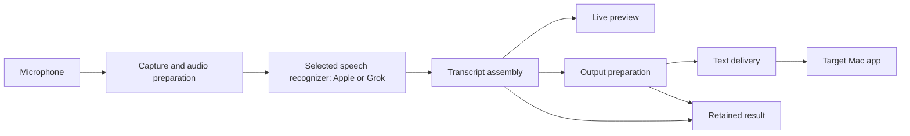

# Transcription system: consolidated research and exploration

Status: research consolidation. This gathers the evidence and exploration that informed the [technical implementation roadmap](transcription-implementation-plan.md). Use that roadmap for the current proposed defaults, Apple Silicon/macOS 26+ baseline, implementation order, and verification requirements. The alternatives and open questions below preserve the research-stage context.

Prepared 2026-11-07 from the project conversation, the [TypeWhisper pipeline audit](typewhisper-transcription-audit.md), and the [earlier technical design exploration](transcription-design.md). The audit contains source references and the original findings; this brief gathers their implications and outstanding questions in one place.

## Product intent and priorities

The user wants a macOS-only application with two features: dictation/transcription and assisted typing. Assisted typing includes word completion, spelling help, and one next-word suggestion. Both features must work across other Mac apps. The interface should allow a distinctive custom design.

The main priority is runtime efficiency and responsiveness, alongside a very small application and little maintainable code. Recognition quality and reliable text delivery constrain the optimization: silently losing speech or inserting duplicate text does not satisfy the goal.

There are two requested providers, Apple and Grok. Each is intended to offer a speech capability and a language-model capability. Grok should accommodate API-key and CLI/OAuth-based access where the specific capability is supported. Provider integration must remain modular and shared between dictation and assisted typing.

Lean means the theorem prover. Its potential role is validating selected algorithms and invariants; its contribution to this application still needs to be established.

The current working focus is microphone dictation into another app, including a live preview and final text. File transcription and meeting recording are adjacent workloads to consider without allowing them to determine the first implementation prematurely.

## What is established, and what remains provisional

| Category | Current position |
| --- | --- |
| User requirements | macOS, cross-app use, custom visual freedom, lean execution and distribution, Apple/Grok providers, modular speech/text capabilities |
| Verified reference behavior | The pipeline and compatibility behaviors recorded in the source audit |
| Supported direction | A native application, separated capture/recognition/delivery responsibilities, bounded resource ownership, explicit session lifecycle |
| Candidate defaults | Swift with AppKit and custom SwiftUI, one streaming recognizer for preview and final text, minimal optional DSP, no mandatory LLM cleanup |
| Unvalidated assumptions | TypeThis will outperform TypeWhisper; a particular buffer size is optimal; native streaming meets our quality/latency targets on every supported configuration |
| Open provider access | Public Grok speech API-key access is documented; CLI/OAuth speech entitlement and a supported integration still require verification |

The existing research is source and documentation analysis. Reference tests were inspected, not executed. No comparative runtime benchmarks or physical-device compatibility study have been performed.

## Functional view of the system

Think in terms of responsibilities and data ownership before choosing classes, protocols, packages, or concurrency primitives.

A session controller coordinates preparation, recording, finish, cancellation, deadlines, and recovery across this flow. Provider integration supplies the recognizer, model availability, authentication, and provider-specific event interpretation. The UI observes small session/preview state. Optional language-model processing belongs in output preparation and should be evaluated independently from speech recognition.

Audio capture readiness, recognizer readiness, recognition completion, and text delivery confirmation are different facts. They should not be collapsed into one ready/completed flag.

## Major boundaries to preserve

| Boundary | Owns | Should not inherit |
| --- | --- | --- |
| Transcription feature | Session policy, audio orchestration, transcript lifecycle, user-visible outcome | Provider-specific authentication or raw protocol messages |
| Provider component | Apple/Grok identity, speech and language capabilities, model availability, credentials and backend adapters | Microphone UI, target-editor mutation, history policy |
| Platform integration | Audio device access and lifetime; text-target discovery and delivery | Recognition model selection policy or prompt workflows |
| Presentation | Custom interface, recording feedback, bounded preview updates | Audio-buffer ownership or network scheduling |
| Result/recovery storage | Retained text, optional retry audio, quotas and deletion | Deciding whether an uncertain external write succeeded |

These are logical boundaries. They do not imply separate processes, dynamic plugins, a package per component, or an interface for every helper.

Speech and language-model selections should be independent: Apple speech plus Grok assisted typing is a valid combination. OAuth and API keys are Grok authentication strategies, not additional providers. Share credentials and provider metadata; keep each feature's session state independent.

## Complete findings inventory

The numbered evidence links correspond to the 20 findings in the audit. This table gathers the lessons relevant to the overall system without importing the reference engine's implementation.

| Finding | System implication | Evidence |
| --- | --- | --- |
| Capture readiness follows actual input, with asynchronous preparation and deferred metadata. | Snapshot lightweight intent early; show readiness honestly; preserve the first word. | [1](typewhisper-transcription-audit.md#1-capture-and-recognition-have-separate-readiness) |
| Default, explicit, Bluetooth, USB, virtual, and aggregate routes have different behavior. | Put capture transport behind a narrow boundary; resolve saved device identity each session. | [2](typewhisper-transcription-audit.md#2-device-selection-needs-an-explicit-capture-policy) |
| A concurrent-call route can need targeted voice processing. | Minimal DSP needs tested compatibility exceptions. | [3](typewhisper-transcription-audit.md#3-capture-compatibility-can-require-targeted-processing) |
| The reference already has a preallocated lock-free HAL ring and frame-loss accounting. | Compare against its actual optimized path; bounded queues also need explicit continuity/loss status. | [4](typewhisper-transcription-audit.md#4-bounded-memory-does-not-establish-lossless-capture) |
| Stopping requires draining accepted audio; short recordings and cancellation differ. | Finish capture, conversion, and recognition in a defined order. | [5](typewhisper-transcription-audit.md#5-stop-is-a-drain-barrier-cancellation-has-different-semantics) |
| Native callbacks may outlive task cancellation and engine stop. | Own native resources through quiescence; prevent old callbacks from reaching a new session. | [6](typewhisper-transcription-audit.md#6-native-callback-lifetime-outlives-a-swift-task) |
| Route recovery, pre-roll rearming, hotkeys, and sleep/wake have failure modes. | Bound restart attempts and serialize cleanup/restart. | [7](typewhisper-transcription-audit.md#7-recovery-must-have-a-circuit-breaker) |
| No input, silence, and the end of a thought are different events. | Use audio time for quiet duration and monotonic wall time for stalls/deadlines. | [8](typewhisper-transcription-audit.md#8-input-liveness-silence-and-turn-completion-use-different-clocks) |
| Signal metrics appear in multiple consumers. | Calculate reusable summaries once; keep metering, activity, conversion, and gain distinct. | [9](typewhisper-transcription-audit.md#9-signal-metrics-can-be-shared-without-adding-a-detector-model) |
| Models have preparation, locale, assets, authentication, and active-use lifetimes. | Freeze session options; represent readiness precisely; protect active model resources. | [10](typewhisper-transcription-audit.md#10-provider-availability-is-a-capabilitymodelsession-property) |
| Advertised vocabulary support can differ from actual model/API behavior. | Validate optional capabilities per model and OS/API version. | [11](typewhisper-transcription-audit.md#11-vocabulary-hints-need-behavioral-validation) |
| Partials, stable segments, utterance finals, and completion snapshots differ. | Normalize revisions explicitly; do not append every result or mistake connection health for recognition progress. | [12](typewhisper-transcription-audit.md#12-connected-producing-partials-and-complete-are-different-recognition-states) |
| Retry scheduling budgets and request timeouts do not necessarily bound the whole operation. | Give each asynchronous phase a deadline and effective resource cleanup. | [13](typewhisper-transcription-audit.md#13-total-deadlines-must-cover-every-asynchronous-phase) |
| A disconnected stream cannot automatically promise resumable recognition. | Retry only through a defined retained-audio policy; prevent invisible replay/duplication. | [14](typewhisper-transcription-audit.md#14-cloud-reconnect-cannot-silently-promise-resume) |
| External apps may ignore, delay, or ambiguously apply text writes. | Keep target identity and delivery certainty separate from recognition success. | [15](typewhisper-transcription-audit.md#15-text-delivery-is-a-transaction-with-uncertainty) |
| Clipboard cleanup has ownership and timing, including after cancellation. | Preserve newer user copies and avoid replacing a paste payload before consumption. | [16](typewhisper-transcription-audit.md#16-clipboard-restoration-is-owned-cleanup-even-after-cancellation) |
| Text transforms can change meaning and invalidate previously processed segments. | Retain provider output, make formatting predictable, and treat LLM cleanup as its own optional stage. | [17](typewhisper-transcription-audit.md#17-post-processing-can-change-meaning-and-invalidate-earlier-work) |
| Handled-failure recovery, crash durability, and history are separate. | Choose audio retention and durability deliberately; a short transport queue cannot replay a full dictation. | [18](typewhisper-transcription-audit.md#18-recovery-history-and-crash-durability-are-separate-features) |
| Persistence can follow insertion; undo requires a verified unchanged target. | Keep storage outside the delivery path and scope any corrective write precisely. | [19](typewhisper-transcription-audit.md#19-persistence-should-follow-insertion-and-undo-must-be-scoped) |
| Long files have different memory, pacing, chunking, and timestamp requirements. | Define a separate file-processing resource policy if that workload enters scope. | [20](typewhisper-transcription-audit.md#20-long-files-need-a-separate-resource-policy) |

Two reference behaviors deserve particular emphasis. Its 350 ms recognition-feed polling and its 10 ms HAL-buffer delivery occur at different layers. Also, its active recovery WAV is deleted after an app crash; that path provides handled-failure recovery rather than a durable recording journal.

## Preview and final text: alternatives to evaluate

| Approach | Recognition work | Potential value | Cost or uncertainty |
| --- | --- | --- | --- |
| One native streaming session | New audio enters one session; drafts become finalized text. | Direct path, live feedback, reuse of recognition work. | Measure final accuracy and backend finalization latency. |
| Separate preview and final recognizers | A preview runs during recording; another pass processes the complete recording. | Allows a different final model or full-recording context. | Additional computation, possible upload, memory/replay storage, and delay; accuracy benefit is unproven for our use case. |
| Repeated batch previews | Overlapping recent windows are repeatedly recognized, followed by full-recording recognition. | Supports models without native live sessions. | Repeated work and more reconciliation; weak initial fit for the requested lean system. |

Both requested providers have native streaming implementations in the inspected reference. One-session streaming is therefore the strongest initial candidate, subject to measurements. A changing final transcript does not establish that a second model ran: native finalization and text formatting can both change the preview.

## Constraints the eventual design must satisfy

- Every accepted audio block has an owner, order, and accounted outcome. Overflow and failed conversion/send cannot disappear into a success result.
- Every session has fixed configuration and identity. Old callbacks, network responses, and cleanup cannot mutate a newer session.
- Capture, model preparation, finish, and external text delivery have separate lifetimes and readiness/completion signals.
- Cancellation prevents future uncommitted actions and still completes necessary cleanup. A posted external paste cannot be assumed undone.
- No automatic duplicate edit follows an uncertain delivery result. Recognized text remains available when delivery fails.
- Memory/resource bounds cover queued audio, outstanding work, transcript growth, retained results, and retry storage together.
- Native framework/model use is measured across the app and associated system services; small app-process memory alone is insufficient.
- Text formatting preserves access to the provider's original output. Original provider output may itself already contain provider-side formatting.
- Shared text mutations invalidate stale autocomplete work and avoid feeding app-generated edits back as human input.

Numeric targets and implementation primitives remain to be selected. The previously suggested two-second queue and approximately 100 ms Grok packets are starting hypotheses, not established optimal values.

## Focused exploration backlog

Each item needs a decision or evidence before the architecture is treated as final. These can be explored without reproducing TypeWhisper's full feature set.

| Question | Starting direction | Evidence or decision needed |
| --- | --- | --- |
| Which Macs, OS versions, languages, and editors must the first version support? | Define a small, explicit support matrix. | Hardware/OS baseline and representative language/editor fixtures. |
| What is the primary activation experience? | Push-to-talk as the working scenario. | Start/stop/readiness behavior, short presses, cancellation, and any need for toggle mode. |
| Which Apple speech module should be offered? | Compare SpeechTranscriber with DictationTranscriber where relevant. | Recognition quality, vocabulary behavior, locale/hardware coverage, latency, and resource use. |
| Can Grok CLI/OAuth authorize both speech and text through a supported integration? | Keep authentication separate from capability access; retain API-key support. | Supported flow, endpoint audience/scopes, refresh behavior, entitlement, and real speech access. |
| Is a second final recognition pass worthwhile? | One streaming session initially. | Paired accuracy and release-to-final measurements on identical recordings. |
| Which capture transport and handoff are sufficient? | Start with a narrow native capture implementation. | Device/call compatibility, callback safety, CPU/wakeups, loss, and tail-drain tests. |
| What preprocessing improves the result? | Minimal conversion/metrics; optional DSP off normally. | Quiet-word/noise corpus, concurrent-call routes, gain/VAD benefits and false rejection rates. |
| What should remain warm between dictations? | Separate model preparation from microphone activation. | Cold/warm latency against idle memory, energy, and route side effects; pre-roll remains optional. |
| How long can dictation run and what can be retried? | Bound total resource use, not just transport buffers. | Duration/byte quotas, whole-session replay need, temporary spool policy, disk-full and crash behavior. |
| What text delivery promise can be made? | Preview panel plus one final delivery attempt with explicit certainty. | AX/paste compatibility, focus/selection changes, Unicode, clipboard preservation, and signed distribution. |
| Which output transforms belong in the first release? | Provider output with small predictable formatting options. | Language-aware behavior, raw-result retention, and whether users need optional LLM cleanup. |
| Which runtime/bundle choices meet the efficiency goals? | Native Swift/AppKit/custom SwiftUI is the current candidate. | Representative UI/capture prototype, release footprint, startup, idle and active profiling. |
| Where does Lean earn its development cost? | Pure accounting, state, and transcript-reduction invariants. | A small useful proof target and a credible connection to executable code; actual speed still needs measurement. |

File imports, meeting recording, speakers, auto-submit, browser/screen context, live in-field replacement, extensive history, and dynamic plugins are expansion topics. Their inclusion should be a conscious scope choice rather than a consequence of using the reference project.

## How exploration should produce a system decision

1. Establish support/workload boundaries and quality expectations. Define what counts as a complete transcript and a successful or uncertain delivery.
2. Resolve provider access/capability uncertainty, especially Grok OAuth speech and Apple vocabulary/module behavior.
3. Use a small capture-to-preview experiment to compare Apple/Grok streaming, preparation policy, and device behavior. It need not contain the final application UI.
4. Test text delivery independently in the target editors. Recognition quality should not obscure insertion failures or clipboard regressions.
5. Compare quality and resource costs, then select the architecture and quantitative budgets. Treat extra DSP, a second pass, warm capture, and persistent recovery as separately measurable additions.

Measurements should include first usable audio, first visible text, release-to-final text, verified delivery, cold/warm startup, idle wakeups, CPU, allocations, peak/retained memory, model/system-service cost, network bytes, and disk writes. Quality checks include word error rate, short/quiet words, false text on silence/noise, missing audio, and duplicate/failed insertion.

The output of this first step is a shared research baseline and prioritized questions. The next system-design artifact should record selected boundaries, resource/lifetime rules, defaults, and unresolved limitations with evidence for each choice.
